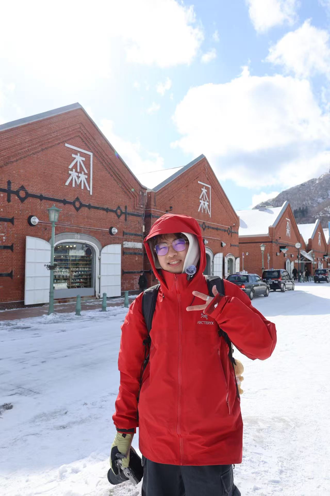

<section class="page" id="home">

<h1 class="name motion-name">Liang <em>(Twist)</em> Shan</h1>

Be Humble, Romantic, Measured, Rosy and Shoot for the Moon.

I’m a third-year undergraduate majoring in <strong>Statistics</strong> in the School of Mathematical Sciences at <strong>Peking University</strong>.

My research interests span the statistical foundations, optimization, and mechanistic interpretability of <strong>modern machine learning</strong>, with a focus on deep learning, reinforcement learning, and generative models including language models and diffusion models. See <a class="bio-research-link" href="/research/">my research</a> for details.

Driven by a curiosity to understand the world, I’m keen on embracing the unfamiliar, exploring new ideas, and turning uncertainty into structure.

<strong>I'm seeking PhD opportunities in Statistics, Computer Science, and Operations Research beginning in Fall 2028.</strong>

<nav aria-label="Contact and profiles" class="socials"><a href="https://scholar.google.com/citations?user=yRkc4iMAAAAJ&amp;hl=en"><svg aria-hidden="true" class="link-icon" fill="none" stroke="currentColor" stroke-linecap="round" stroke-linejoin="round" stroke-width="1.6" viewbox="0 0 24 24"><path d="m2 9 10-6 10 6-10 6zM6 12v6c4 3 8 3 12 0v-6M22 9v8"></path></svg>Google Scholar ↗</a><a href="https://github.com/Twist-Shan"><svg aria-hidden="true" class="link-icon" fill="none" stroke="currentColor" stroke-linecap="round" stroke-linejoin="round" stroke-width="1.6" viewbox="0 0 24 24"><path d="M9 19c-5 1.5-5-2.5-7-3m14 6v-4a3.5 3.5 0 0 0-1-3c3-.3 6-1.5 6-6a5 5 0 0 0-1.5-3.5A4.7 4.7 0 0 0 19.4 2S18.2 1.7 16 3a12 12 0 0 0-8 0C5.8 1.7 4.6 2 4.6 2a4.7 4.7 0 0 0-.1 3.5A5 5 0 0 0 3 9c0 4.5 3 5.7 6 6a3.5 3.5 0 0 0-1 3v4"></path></svg>GitHub ↗</a><a href="https://www.linkedin.com/in/liang-twist-shan"><svg aria-hidden="true" class="link-icon" fill="none" stroke="currentColor" stroke-linecap="round" stroke-linejoin="round" stroke-width="1.6" viewbox="0 0 24 24"><rect height="18" rx="2" width="18" x="3" y="3"></rect><path d="M7 10v7m4 0v-7m0 3a3 3 0 0 1 6 0v4"></path><circle cx="7" cy="7" r=".6"></circle></svg>LinkedIn ↗</a><a href="https://x.com/LiangTwistShan"><svg aria-hidden="true" class="link-icon" fill="none" stroke="currentColor" stroke-linejoin="round" stroke-width="1.5" viewbox="0 0 24 24"><path d="M4 3h4l12 18h-4zM20 3 4 21"></path></svg>X ↗</a><a href="https://www.instagram.com/twist_shan/"><svg aria-hidden="true" class="link-icon" fill="none" stroke="currentColor" stroke-linecap="round" stroke-width="1.6" viewbox="0 0 24 24"><rect height="18" rx="5" width="18" x="3" y="3"></rect><circle cx="12" cy="12" r="4"></circle><circle cx="17.5" cy="6.5" fill="currentColor" r=".8" stroke="none"></circle></svg>Ins ↗</a><a href="/files/cv_Liang_Shan.pdf"><svg aria-hidden="true" class="link-icon" fill="none" stroke="currentColor" stroke-linecap="round" stroke-linejoin="round" stroke-width="1.6" viewbox="0 0 24 24"><path d="M14 2H5v20h14V7zM14 2v5h5M8 12h8M8 16h6"></path></svg>CV ↓</a></nav>
<figure class="portrait"><figcaption class="portrait-email">twistshan1218@gmail.com</figcaption></figure>

<section>
<small>01</small><h2>Education</h2>
<article class="education-row"><time>2023.08 — 2028.07</time><h3>Peking University</h3>
B.S. in Statistics · B.A. in Economics
</article><article class="education-row"><time>2025.08 — 2026.01</time><h3>University of Copenhagen</h3>
Exchange student · Department of SCIENCE
</article></section><section>
<small>02</small><h2>News</h2>


<time>{{ item.date }}</time>
<a href="{{ item.link }}">{{ item.text }}</a>{{ item.text }}


</section>
<section class="contact-section">

Questions, ideas, or collaboration?
<h2>Feel free to contact.</h2>

<a href="mailto:twistshan1218@gmail.com">twistshan1218@gmail.com ↗</a>
WeChat: Twist_SsLl

</section></section>
